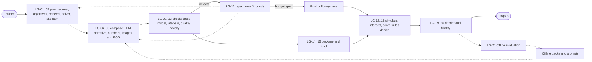

# Pipeline JSON guide

`procsense_full_pipeline.json` is the **canonical** description of the whole ProcSense AI and live-generation plan: every stage, component, store, dataset, model, feature, phase, rule, fallback and open question, and how they connect. The Markdown planning files in this folder are generated from it. Edit the JSON, never the generated files.

## 1. Commands

| Command | What it does |
|---|---|
| `uv run --project tools tools/plans/validate_pipeline.py` | Checks the JSON (rules VR-G-*) and prints a summary |
| `uv run --project tools tools/plans/test_validate_pipeline.py` | Proves the validator catches 15 kinds of breakage |
| `uv run --project tools tools/plans/check_planning_sync.py` | Cross-document check: plan files, exports, step files, milestones, cited ids (documents to JSON), DT register, stale wording |
| `uv run --project tools tools/plans/pipeline_docs.py` | Regenerates the derived files below |
| `uv run --project tools tools/plans/pipeline_docs.py --check` | Fails if a derived file is out of date (CI) |

Derived files: [feature_registry.md](feature_registry.md), [live_generation_spec.md](live_generation_spec.md), [dataset_feature_matrix.md](dataset_feature_matrix.md), [model_technology_register.md](model_technology_register.md), [master_roadmap.md](master_roadmap.md), [pipeline_overview.mmd](pipeline_overview.mmd), [procsense_pipeline.cytoscape.json](procsense_pipeline.cytoscape.json), [feature_coverage_audit.md](feature_coverage_audit.md), `docs/plans/features/<ID>.md` (69 files) and `flows/*.json` (10 Synverk diagrams, section 5).

## 2. Schema (version 1.0.0)

| Field | Content |
|---|---|
| `schema_version` | Semantic version of this format. Bump the minor version for new optional fields, the major version for renamed or removed fields. |
| `project` | Name, description, canonical file path. |
| `metadata` | Dates (UTC), planning rule, baseline commit, generated files, critical path, parallel work, documented cycles, the novelty specification, assumptions. |
| `legend` | Node types, edge types, the eight status words, method classes, id conventions. |
| `groups` | Subgraphs. `parent` nests a group (for example the five live-stage groups inside `g_live`; the five feature categories inside `g_features`). |
| `nodes` | Every node. Common fields: `id`, `type`, `label`, `group`, `status`, `description`, `evidence`. Stage nodes add `stage_no`, `inputs`, `outputs`, `component`, `method`, `method_class`, `data_dependencies`, `api`, `error_handling`, `validation`, `tests`, `acceptance`, `latency_budget_ms`, `blockers`, `tasks`. Feature nodes add `kind`, `ai_status`, `lineage`, `llm_first_classification`, `model_refs`, `dataset_refs`, `realised_by`, `depends_on`, `overlaps`, `deterministic_guard`, `fallback`, `tests_planned`, `phase`, `tier` and `plan` (user experience, exists, missing, deterministic foundation, the seven `ai_questions`, `capabilities` each with schemas, flow, validation, five-case `failure_handling`, tests, metrics, baseline, acceptance, `hardware` for both GPUs and tasks, `integration`, prerequisites, status rationale, reassessment, staged versions, deliverables, definition of done, status history). Runtime-step nodes (LP-01 to LP-03) are the learner-profile steps. |
| `edges` | `id`, `source`, `target`, `type`, `label`; optional `condition`; optional `cycle` (`id`, `bound`, `note`) on the edge that closes a documented loop. |
| `external_dependencies` | Libraries and runtimes with licence, source URL and install state. |
| `datasets` | DS-0001 to DS-0014 with licence, status, modality, normal and abnormal notes, planned analysis, restrictions, the nodes they feed and the features that use them. |
| `model_catalog` | MC-01 to MC-13: purpose, candidates, default, hardware, latency, local or remote, internet, privacy, licence, structured output, evaluation, cost, fallback, why not simpler, status. |
| `phases` | PH-01 to PH-19: objective, dependencies, status, deliverables, acceptance, tasks (plan step ids), features, critical-path flag. |
| `validation_rules` | VR-D (data), VR-CM (cross-modal) and VR-G (graph) rules with where each is enforced. |
| `fallback_paths` | FB-01 to FB-10. |
| `open_questions` | OQ-01 to OQ-08; none blocks development. |

**Ids.** Dataset and model nodes share their id with their catalogue entry on purpose (the node is the graph handle of the entry). Feature ids run A1 to E65 and then A66, D67, D68, E69 (added in the second pass), with the letter giving the category; they are never renumbered. Task ids are plan step ids, so every task has a step file under `docs/plans`.

**Statuses.** Implemented and tested · Implemented but incompletely tested · Partially implemented · Planned · Blocked · Deferred · Proposed new feature · Superseded or rejected. A feature's `status` is the whole feature; `ai_status` is only its model-driven part.

## 3. What the validator checks

| Rule | Check |
|---|---|
| VR-G-PARSE | Parses; all 14 top-level fields present |
| VR-G-UNIQUE | Unique ids in every list; a task belongs to one phase only |
| VR-G-ENDPOINTS | Every edge's source and target is a node |
| VR-G-REFS | Groups, parents, edge and node types, statuses, models, datasets, phases, features, nodes and plan step files all exist |
| VR-G-COVERAGE | Every feature is realised by a node and has a task inside a phase |
| VR-G-ENTRY-EXIT | Every live and offline stage is reachable from an entry and reaches an exit; exits have no outgoing flow |
| VR-G-CYCLES | Removing the edges marked `cycle` leaves the flow graph acyclic; every cycle edge has a bound |
| VR-G-TRACE | Every node and edge has `traced_to` (feature plans and plan step files that exist); `realised_by` and `depends_on` edges equal the feature plans' fields in both directions; each phase's feature list equals the features that name it |
| VR-G-HONEST | Anything marked Implemented and tested cites evidence paths that exist; nothing implemented points at planned code |
| VR-G-PLANS | Every feature has a complete plan; AI features have a separate AI capability; partially implemented AI features have a separate plan for the missing AI part; blocked and deferred features list prerequisites; every capability's tasks have step files inside a phase |

Results on 12 October 2026 (second pass): **PASS, 0 errors** (168 nodes, 386 edges, 18 groups, 69 features, 24 phases, 14 datasets, 13 models, 26 rules, 11 documented cycles, 2 entries, 2 exits, 34 stages and steps); coverage 69 of 69 complete plans, 69 of 69 mapped to phased tasks, 105 capability plans (65 AI); traceability 166 of 168 nodes direct (DS-0008 and DS-0013 are considered-and-not-used datasets, traced via the dataset register) and 386 of 386 edges traced; validator tests **16 of 16**.

## 4. Visualising it

**Recommended tool: Cytoscape.js** (MIT; https://js.cytoscape.org). It draws compound nodes (our groups) natively and reads an `elements` array.

The transformation (done by `pipeline_docs.py` into `procsense_pipeline.cytoscape.json`):

| Pipeline JSON | Cytoscape element |
|---|---|
| each group | `{"group": "nodes", "data": {"id", "label", "kind": "group", "parent"}}` |
| each node | `{"group": "nodes", "data": {"id", "label", "type", "status", "parent": <group>}, "classes": <type>}` |
| each edge | `{"group": "edges", "data": {"id", "source", "target", "type", "label", "cycle"}, "classes": "<type> [cycle]"}` |

To view it, load the file's `elements` into a page with Cytoscape.js and a layout that supports compound nodes (for example the built-in `cose`), and style by class (`stage`, `feature`, `fallback`, `cycle`...). Filtering to `data_flow`, `repair`, `fallback` and `feedback` edges gives the pipeline; adding `realised_by` shows which features each stage delivers. Cytoscape Desktop can also import Cytoscape.js JSON; that route was not tried here.

**Quick overview: Mermaid.** `pipeline_overview.mmd` shows only the entries, exits, offline steps, live stages and their flow edges, grouped in subgraphs. Paste it into any Mermaid renderer. A hand-drawn summary:

## 5. Synverk flow diagrams

`flows/*.json` are the same pipeline in the Synverk flowchart format (`$schema` `/api/flows/schema`, fields `title`, `subtitle`, `columns`, `nodes[id, actor, label, title, text, tone]`, `edges[from, to, label]`, `notes`). They are generated by `tools/plans/pipeline_flows.py` (called by `pipeline_docs.py`) and checked by `pipeline_docs.py --check` and `check_planning_sync.py`.

The schema allows at most 30 nodes, 60 edges and 6 notes per flowchart (read 12 Oct 2026, see R-012 in the research log), so the 168-node pipeline is split into ten linked diagrams. Each is well under 64 KB (the whole set is about 79 KB).

| File | Content | Nodes / edges |
|---|---|---|
| `00-live-pipeline.json` | The whole live pipeline: LG-01 to LG-21, learner profile LP-01 to LP-03, entries, exits, fallback, offline preparation as one node | 30 / 49 |
| `01-offline-and-datasets.json` | OFF-01 to OFF-10, the 14 datasets, packs, blocks, knowledge base | 27 / 22 |
| `02-models-and-stages.json` | Models MC-01 to MC-13 and the stages that use them | 25 / 14 |
| `03-components-and-stages.json` | Existing and planned components and the stages they serve | 27 / 22 |
| `04-roadmap-phases.json` | Phases PH-01 to PH-24 with dependencies and the critical path | 24 / 40 |
| `05` to `09-features-*.json` | The 69 features by category A to E, with their dependencies | 14 to 19 per file |

How the JSON maps to the format: a box's `label` is its id in the canonical JSON (features: id, tier, phase), `title` a short name, `text` the status plus the first sentence of the description and the feature plans that trace to it, `tone` the status (mint built, sun partly built, blue planned, aqua proposed, coral blocked, grey deferred), `actor` a fixed icon per node type or stage. Edges come from the JSON's flow edges; edges to nodes outside a diagram are dropped, so use the Cytoscape export when you need every edge. The generator raises an error rather than cutting content if a diagram would break a limit.

Not verified: the files have not been opened in the Synverk renderer (the Synverk MCP server needs sign-in), and the allowed `actor` and `tone` values were taken from a summary of the schema, not its raw text.

## 6. Changing the plan

1. Edit `procsense_full_pipeline.json` (keep ids; add new ones at the end of their range).
2. Run the validator, then `pipeline_docs.py`.
3. If a task is new, add its step file under `docs/plans` and run `uv run --project tools tools/plans/milestones.py`.
4. Keep `docs/deferred-tasks.md`, `docs/ai-roadmap-status.md` and `docs/context` in step (INSTRUCTIONS.md section 8h).
